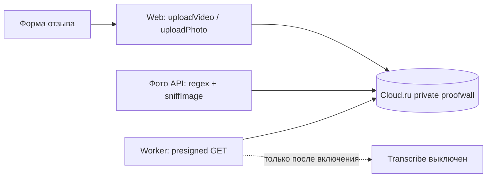

# Лёгкая архитектура

## Компоненты

Web пишет видео и фото в частный бакет; фото читает существующий API, worker подписывает GET. БД хранит прежний key, постоянные S3 URL не добавляются. Изменение прикладной авторизации не требуется.

## Конфигурация и границы
Cloud.ru задаётся окружением; MinIO остаётся опциональным локальным профилем без mandatory depends_on у web/worker. Оба сервиса получают S3_REGION и S3_FORCE_PATH_STYLE. Один private bucket не означает public-read policy. Новых exports, схем, сервисов и зависимостей нет. HTTPS sslip.io на VPS относится к основной задаче поставки, отдельный домен здесь не выбирается.

## Observability
Сохраняются существующие ошибки upload/read и worker; снаружи сбой заметен по 503 при фото/загрузке и существующим статусам обработки. Оператор смотрит error события storage и количество неуспешных медиа-CJM шагов; новый мониторинг не объявляется установленным. Не логировать credentials, Authorization или presigned URL. Пока пользовательских ключей нет, доступ к backend и работоспособность worker не подтверждены; транскрипция остаётся выключенной.
