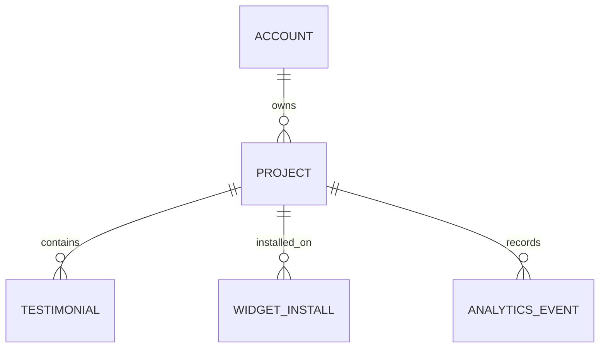

# Domain model: read-only dashboard

## Контексты и язык

| Термин | Значение/authority |
|---|---|
| Владелец | Account из подтверждённой серверной session, не request account_id |
| Стена/проект | Existing projects row; aggregate root для testimonials/installs/events |
| Активная стена | `projects.deactivated = false`; только такие входят в overview |
| Название | Непустой строковый `branding.name`, иначе slug |
| Действующий тариф | Existing `isPaid(tier, paid_until, now)`; не значение tier само по себе |
| Всего отзывов | Все testimonials rows pending/approved/rejected/hidden за всё время собственного активного проекта |
| На проверке | Точное число pending за всё время собственного активного проекта |
| Домен с активностью виджета | Наблюдённая пара project/domain по config-запросам с last_seen_at в 30-дневном окне; не доказательство текущей установки |
| Клик badge | Логированный `analytics_events.event_type = badge_click`; не уникальный человек |
| Неизвестная метрика | Отсутствующий источник/измерение, typed null, не числовой 0 |

Контекст Identity обслуживает cookie→account; Projects владеет project/branding;
Growth содержит telemetry; Billing вычисляет effective tier. Dashboard — read projection
этих существующих контекстов, новых агрегатов/команд/таблиц не создаёт.

## Отношения



`DashboardOverviewModel` — ephemeral presentation DTO. Он содержит summary, subscription
copy/action, metrics с `number | null` и labels, project cards, empty state и optional
locked demo card только у test fixture. Все строки — plain text; никаких HTML полей.
Тип объявлен рядом с pure view; data module использует только erased `import type`.
Это осознанная локальная связь, без нового shared package для одного экрана.

## Инварианты

1. Любой database read overview проходит `withAccount` и ограничивает active project scope.
2. Summary/card counts производятся строго одним data SQL statement; independent aggregate subqueries
   не размножают строки при соединении testimonials×events×installs.
3. Одно `now` задаёт границы `[now−30d, now)` и effective paid; оно не приходит из HTTP.
4. Unknown сохраняется до рендера; только успешная пустая aggregate выборка даёт 0.
5. Ошибка data access не возвращает валидный пустой DTO; Next error boundary разрешает retry.
6. Billing read-only; unknown/expired paid fail-closed как existing helper.
7. Dashboard click использует slug→existing project route; не передаёт foreign project id.

## Состояния

```text
request → session absent/expired/revoked → login redirect (нет project data)
request → session valid → read failed → error boundary → retry read
request → session valid → read ok, 0 active projects → empty overview
request → session valid → read ok, 1..N projects → populated overview
```

Метрики известны/неизвестны независимо от числа проектов. Paid/free/mixed — проекция
active projects, не состояния нового account subscription. У dashboard нет write side.

Пример: 4 rows (по одному каждого статуса), в том числе старше 30 дней → total=4,
pending=1. Observed domain metric повтор одной пары не увеличивает; две стены одного
домена дают 2; несуществующая domain row не считается. Политики RLS независимо
проверяются прямыми SELECT четырёх таблиц без tenant WHERE с контролем role/GUC.
