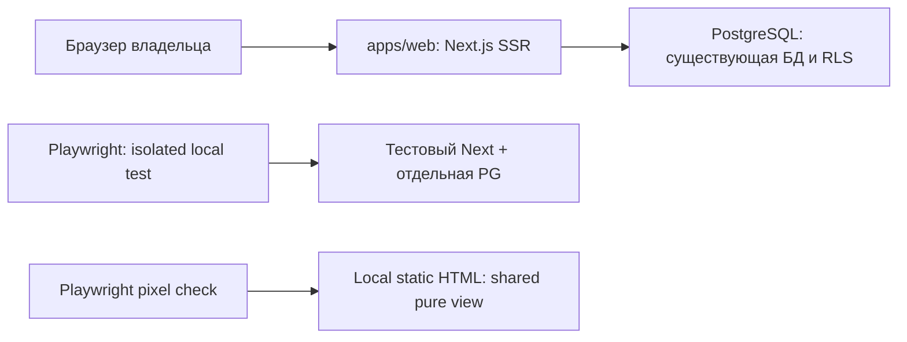

# Архитектура первого рабочего dashboard

Статус: ready for QCSD/review, не допуск к коду. Основание: `01_requirements.md`,
`02_research.md`, ADR-001/ADR-002, `04_domain_model.md`, существующий общий план.

## C4 Context

Владелец открывает Proofwall по HTTPS; Next.js проверяет existing session и читает
PostgreSQL. Overview ничего не отправляет email/payment/STT/storage провайдерам.
Новые внешние сервисы и домены не вводятся.

## C4 Container



## C4 Component

```mermaid
flowchart TD
  Route[/dashboard page.tsx] --> Session[currentAccountId]
  Route --> Data[getDashboardSummary]
  Data --> Tenant[withAccount + one SQL snapshot]
  Data --> Tier[isPaid existing helper]
  Route --> View[DashboardOverview model props]
  View --> CSS[Scoped preview CSS + byte-exact fonts]
  Data -. failure .-> Error[error.tsx retry boundary]
  Fixture[tests frozen presentation model] --> View
  Fixture --> Render[renderToStaticMarkup local artifact]
```

## Модули и контракты

| Файл | Ответственность |
|---|---|
| `apps/web/src/app/dashboard/page.tsx` | force-dynamic, metadata noindex, currentAccountId → login redirect; await model; render view |
| `apps/web/src/lib/dashboard-summary.ts` | `getDashboardSummary(accountId, now = new Date())`; single SQL aggregate snapshot, isPaid, live DTO |
| `apps/web/src/app/dashboard/dashboard-overview.tsx` | `DashboardOverview`, `DashboardOverviewModel`; pure presentation, no runtime DB/Next/env imports |
| `apps/web/src/app/dashboard/dashboard.css` | Exact relevant preview declarations, dashboard-scoped resets/tokens/typography |
| `apps/web/src/app/dashboard/error.tsx` | Client error boundary, human message and real `reset()` retry; no raw SQL/secret text |
| `apps/web/public/proofo/body.woff2`, `display.woff2` | Byte-exact local fonts from chosen preview |
| `apps/web/tests/dashboard-overview*.test.ts` | Unit/SSR/RLS/error/compatibility checks; no real mail |
| `apps/web/tests/dashboard-visual-fixture.test.ts` | Render same view to isolated artifact using createElement; no Next route |
| `tools/visual/dashboard.e2e.test.mjs` | Browser against actual Next+PG via ordinary session |
| `scripts/render-dashboard-fixture.mjs` | Invokes fixture rendering and serves only local artifact/assets |
| `scripts/run-dashboard-preview.mjs` | Safe local env + isolated preview launcher; no production dotenv import |

## Query algorithm

1. Resolve session server-side; absent → redirect before query.
2. Capture one `now`, derive UTC start by exactly 30×24 hours.
3. `withAccount(accountId)` подготавливает role/GUC; ровно один data SELECT получает
   всю проекцию собственных active projects, ordered created_at,id.
4. Within that one SQL statement aggregate all-time testimonials total (все четыре
   статуса, подпись «Всего отзывов») и all-time pending («На проверке»);
   aggregate badge_click filtered by event type, owned active project, start≤created_at<now;
   aggregate widget_installs filtered by owned active project, start≤last_seen_at<now.
   Use pre-aggregated subqueries/CTE, not a Cartesian join of child tables.
5. Normalize numeric count outputs; reject unsafe/non-finite counts rather than silently
   round invalid data. Build project title and isPaid using same now.
6. Construct read-only presentation DTO with unknown wall/widget metrics, known counts,
   truthful per-project billing and existing project links. React escapes all text.
7. Render pure view. Exceptions reach error boundary; no catch→empty model.

## Visual и live границы

Frozen source — preview `e2e2f96`, tree `d9acba4e57aacbd35c2736523d08a8874f744b30`.
Первый capture v1 диагностически отклонён: clip обрезал длинный mobile shell по viewport.
Его файлы остаются immutable и не служат baseline. Canonical initial freeze записывает
полный shell (`fullPage:true`, ceil bounding box), после `display:none` только для
`.cab-notice` и `#preview-tools` в reference. Это предварительно согласованные demo-only
exclusions; fixture не получает spacer или особый отступ. Финальный directory — `dashboard-v3`; manifest SHA-256
`e7999b11e9fb68cf57f64323c624df5d70693d366d1d69be01a1d7e9e3101684`.

Baseline region `main.cab-shell` сохраняет brand/back, фон, шрифты, article и все карточки.
Fixture wrapper повторяет live wrapper. Она содержит literal demo values как вход view;
production loader этих values не знает. Actual screenshot checker не меняет CSS страницы.
Runtime fonts await `document.fonts.ready`; browser/OS/DPR/locale/timezone фиксированы.
Live E2E отдельно проверяет hydration, session, навигацию, DB changes, error→retry и RLS.
Fixture загружает тот же globals.css перед dashboard.css; обе страницы имеют
`.proofo-dashboard` wrapper. Dashboard-only body:has(.proofo-dashboard) задаёт
реальные body fonts/background без изменения остальных страниц. HTTP E2E сравнивает
body font/background color/image/size/position и shell origin/width/padding против
fixture/reference. Body входит в contract вне crop; synthetic body, iframe и spacer
не разрешены. Полная высота live может отличаться из-за реальных данных.

## Threat/testability review до реализации

| Риск | Дизайн ограничения | Проверка |
|---|---|---|
| Tenant leak | Existing withAccount + RLS + active scope | A/B настоящая PG, счётчики и карточки |
| Join умножает counts | Independent aggregates in one statement | Несколько child rows каждой таблицы |
| Клиент меняет now/tier | Только server function inputs | Source review; обычный HTTP без overrides |
| Fake 0 или paid | Typed null + isPaid | Unit/DB expired and unavailable |
| XSS из branding | Plain React text; no raw HTML | Script-like title SSR/browser |
| Baseline обход | Immutable manifest; check never captures | Missing/mutated baseline refusal, 3 visual mutations |
| Фиктивный E2E | Static fixture и live SSR — разные доказательства | Cookie login, isolated PG, foreign project refusal |
| CSS регрессия | Dashboard scoped styles | Existing project route desktop/mobile |

Shift-left protocol прочитан и применён к named acceptance tests и design risks.
QCSD role findings/convergence ведёт координатор; этот авторский анализ не независимый swarm.

## Конкретные проверки условий QCSD

- QUALITY-1/2: один отзыв каждого статуса (включая старше 30d) даёт total=4/pending=1;
  deactivated/foreign исключены. Метрика «Домены с активностью виджета» с пояснением
  «За 30 дней по обращениям к виджету; один домен с двумя стенами считается дважды»;
  duplicate config same pair не растит count; две стены same domain дают 2; missing
  registered domain не считается. Это не подтверждённые текущие установки.
- RISK-1: query-count/source assertion фиксирует один data SQL statement после role/GUC
  setup. Multi-command READ ONLY альтернатива запрещена; отдельного concurrency gap
  между чтениями не существует, snapshot всего результата определяется statement.
- RISK-2/TEST-1: seed отдельной service role; real withAccount(A) проверяет current_user,
  app.current_account_id, rolbypassrls=false и отсутствие table ownership. SELECT без
  owner/project WHERE по projects/testimonials/analytics_events/widget_installs видит
  свои rows и не видит B; aggregate/deactivated проверки идут отдельно.
- TEST-2: после успешного session login только в isolated PG выполнить REVOKE SELECT
  ON analytics_events FROM app_authenticated. Сессия через withService продолжает
  работать; запрос overview должен попасть в summary error state, не []/0. В finally
  выполнить GRANT SELECT и нажать настоящий retry → данные восстановлены. Отдельный
  session-store failure test подтверждает failure без данных, не засчитывается за
  summary error. Никаких HTTP error switches или production GRANT изменений.
- TEST-3: named E2E `live dashboard and fixture share body styles and shell geometry`
  проверяет настоящий HTTP SSR, загруженный CSS и вычисленные стили; exact fixture
  baseline дополнен этим доказательством, не заменяет его.
- TEST-4: длинное непрерывное Unicode, multiline и HTML-like имя на 360×800/390×844/
  1440×900: document scrollWidth ≤ viewport, видимое accessible name, Tab достигает
  карточки, focus indicator виден, Enter открывает фактический project URL; XSS и
  slug fallback отдельно. Не маскировать текст или overflow ради visual pass.
