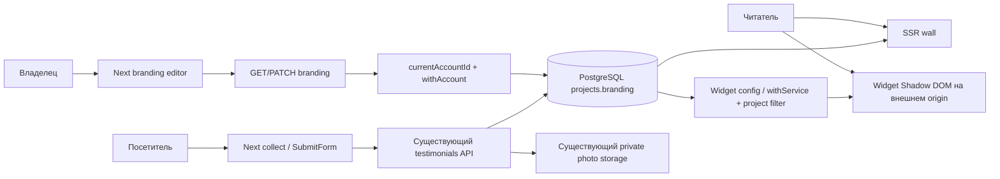

# Branding + collect — архитектура

Settled inputs для QCSD, до admission K1/K2. Source HEAD 4da1c64; решения ADR-001,
ADR-002, ADR-003, ADR-004. App/tool source files не создавались этим планированием.

## C4 Context / Container / Component

Внутри web: `branding.ts` — canonical reader, strict patch validator и contrast helper;
`project-branding.ts` — owned select/atomic merge; route — auth/origin/body/status boundary.
`branding-editor.tsx` — state/fetch; `branding-view.tsx` — pure UI. `collect-view.tsx`
выводит модель состояния; существующий SubmitForm сохраняет handlers/fetch/preview.
`intake-tabs.tsx` сохраняет flag policy. Изменения CSS scoped под новые формы/wall.
Existing `/dashboard/[slug]/page.tsx` получает только ссылку «Оформление стены» на owned
slug; branding page возвращает в этот проект. Dashboard overview/CSS/stable artifact
не меняются. У widget изменения только в его shadow-root.
Branding form noValidate + explicit dirty-patch validation не даёт native HTTPS pattern
заблокировать theme Save при legacy HTTP logo. Сервер всё равно отвергает новое HTTP.
Ни isFixture, ни test-only switch в production components не вводится; literal model
отличается данными, не веткой validation/разметки ради теста.

Раздельные диаграммы: `diagrams/architecture-c4.mermaid`, `domain-model.mermaid`,
`sequence-branding-save.mermaid`, `sequence-branding-refusal.mermaid`,
`sequence-collect-photo.mermaid`. Они описывают предложенный поток, не runtime traces.

## API design и sequence flows

GET `/api/projects/[slug]/branding`: 200 `{branding}`, 401 session absent, 404
foreign/missing/inactive, 503 DB failure. Private/no-store; owner page использует тот
же repository, не собственный service query. PATCH: auth → Origin/Fetch-Site → JSON
Content-Type → readBodyAtMost(4096) → parse/validate → tenant lock/merge → commit →200.
400 bad patch; 403 origin; 413 actual body bytes; 415 type; 409 stored non-object JSON;
503 permission/database fault. Body parsing до write transaction, auth чтение отдельно.
Ошибки `{errors:[...]}` или `{error:...}` совместимы с form status model.

Public reads: Branding defaults → theme tokens, validated accent + accessible foreground.
Цветовые роли различаются: accentFill сохраняет HEX, onAccent выбирает black/white с
максимальным контрастом на fill; accentText на каждом surface использует HEX только
при ratio≥4.5, иначе black/white с максимальным ratio на этом surface. Essential
border/focus получают отдельные ≥3:1 tokens для всех необходимых control boundaries;
focus на двух фонах имеет inner/outer ring.
Essential surfaces непрозрачны, opacity не применяется к значимому тексту. Saved HEX
не переписывается ради contrast; collect остаётся light при обоих project themes.
Wall query sort только из двух статических SQL вариантов, created_at/id tie-break.
Widget query CTE latest50 DESC,id DESC → outer requested order. Все filters до LIMIT.
Существующий трёхпольный Branding input не расширяется обязательными ключами.
Новый ResolvedBranding extends Branding материализует новые defaults в readBranding;
старые form/video typed literals продолжают компилироваться. Новый typed WidgetBranding
DTO `branding?` содержит только theme/accent_color/show_platform_labels; heading/logo
не обещаны widget UI. Older widget игнорирует добавленное поле; absent/new malformed
network values fail-safe в renderer, никакого raw CSS/innerHTML.
Source_label/source_url/screenshot остаются доступны: false выбирает neutral caption,
не меняет text/excerpt и не убирает screenshot при наличии source URL.
Server badge_required/badge_url logic не меняется; 50 не превращается в тарифный лимит.

## Data & storage / миграции

Новых SQL migrations **0**: existing projects.branding JSONB и grants достаточны по коду.
Read defaults дают additive rollout, старый reader продолжает понимать три старых ключа.
Обязательный schema test: создать отдельную БД существующими migrations, проверить
пустой/legacy/malformed JSON, независимые concurrent patches, имя, foreign RLS, revoked
UPDATE и rollback старого reader. Применять к production/общей БД запрещено.
Instrumented test client наблюдает current_user/GUC именно в момент production owner
SELECT/UPDATE, на том же соединении/transaction. Отдельный withAccount probe недостаточен.
Мутант withService + прежний explicit account filter обязан быть обнаружен даже при
сохранённом результате foreign-denial. Test instrumentation не добавляется в product API.
Если окажется нужна новая SQL migration — сначала ADR/plan/targets/K1/K2 revision.
Logo browser-loaded HTTPS URL, не server-side fetch и не S3 uploader. Photo pipeline
reuse полностью; access contract и ограничения доказательств описаны в research.

## UI и QE

Frozen `reference/dashboard-v3`: branding/collect × 1440×900,390×844,360×800;
DPR1, ru-RU, UTC, frozen clock, fonts/browser/OS hashes, crop .cab-shell, zero masks.
Same production view + literal frozen model только в offline fixture. Existing visual
script already supports both screens; fixture server loopback, вне Next routes.
Owner decision `evidence/design/owner-decision.json` (2026-11-12, «выбери контрастнее»):
обычные branding/collect containers всегда передают approved palette с fieldBorder
#8e806b, fieldFill #f7f4eb, cardSurface #fffdf8. Generic readonly palette props входят
в существующие BrandingViewModel/CollectViewModel; scoped CSS получает эти значения
из props. Это внутренние presentation data, не новый control/DB key/HTTP параметр.
Offline renderer передаёт original literal palette (fieldBorder #ddd3c2) тому же
component. Ни isFixture, ни mode switch, seed/auth/query/header override не вводятся.
Шесть frozen zero-diff кадров доказывают component/layout на эталонных данных;
живой runtime имеет одобренное отличие цвета рамок и отдельный computed contrast test.
Production models не получают prototype rating/video/tariff promises. Live E2E отдельно:
обычный login, own/foreign/expired, save/reload, text/photo pending→approve→wall/widget,
400/429/503/network errors, focus/keyboard/long strings, false video flag.
Все external calls в тесте блокируются, storage synthetic/local; реальная почта/STT/payments не вызываются.
Новые states получают evidence и owner review отдельно, без обновления frozen goldens.

### Контракт клиентской валидации и состояния

Collect noValidate + explicit validation повторяет существующие server formulas:
name.trim().length 2–80 UTF-16 units, role raw.length≤120 до blank→null, text raw.length
10–2000. Не добавлять trim/truncate или native raw min/max, блокирующий padded name.
name/raw nonblank role/text отправляются без изменений; counter считает raw units.
Browser+HTTP oracle: space+80letters+space →201 и DB raw82; trimmed1/81 →client
error/no fetch, bypass400 без record/upload/quota. Role raw120 с краевыми пробелами
сохраняется; 120spaces→null, 121spaces→400. Text10spaces→201, raw9/2001→400.
Backend testimonial module не меняется: UI согласуется с existing contract в 30 targets.

Branding Save валидирует dirty payload, захватывает draft и блокирует весь fieldset:
все шесть settings, color picker и HEX, Save. Pending не допускает edits/второй PATCH.
200 применяет canonical response, очищает dirty, разблокирует; любой failure сохраняет
захваченный draft и разблокирует. Две вкладки независимо читают server state: разные
dirty keys merge, одинаковый key last committed wins. На reload обе видят итог.
Versioned optimistic draft не вводится; delayed-response test пытается менять каждый
control и проверяет один точный payload, immutable pending draft, затем success/error.

Каждый input, file и color control имеет label-for/id; picker и HEX имеют разные имена.
Hint/error связаны aria-describedby; invalid поле aria-invalid. Pending form aria-busy,
visible role=status aria-live=polite находится вне disabled fieldset и получает focus
через tabindex=-1. Failure снимает busy/disabled, сохраняет draft, фокусирует visible
error summary role=alert/tabindex=-1; links фокусируют соответствующее invalid поле.
Success200/201 фокусирует visible status/thanks с announcement. Keyboard Tab/Shift+Tab/
Enter/Space без trap. Legacy HTTP unrelated theme Save проходит; edited HTTP даёт
HTTPS error у logo, summary focus и no write. Проверяются client/400/429/503/network.
Oracle: browser AX tree имён, DOM label/describedby relations, document.activeElement,
видимые messages/state и keyboard flow. Удалённая error/relationship должна ломать тест.
Manual real screen-reader evidence требуется на owner acceptance опубликованной test
copy; DOM pass не объявляет его pass или production acceptance.

### Живые визуальные oracles, отдельно от frozen proof

Computed contrast test разрешает CSS colors и alpha по ancestor chain до opaque surface,
проверяет heading/link, button label/fill, controls/focus, status/error, provenance/badge
в form/wall/widget. Text≥4.5, large text≥3 (≥24px либо ≥18.66px bold), все необходимые edge/
focus≥3 к соседнему фону. Набор HEX #FFFFFF/#000000/#F8F8F8/#181818/#777777 × обе темы.
Мутант raw white accentText на light heading обязан упасть даже при правильном onAccent.
Unit helpers и Shadow DOM получают те же cases; calculated token alone не browser proof.
Live forms field border #8e806b имеет расчётный ratio3.5035 к fill #f7f4eb и3.7903
к card #fffdf8; старый #ddd3c2 остаётся только в offline palette. Live oracle для
input/textarea/select/color и необходимой photo field boundary проверяет computed
borderColor, fill и соседнюю card после compositing в idle/error/focus states;
необходимые другие boundaries/focus также ≥3. Native control indicator проверяется
в фактическом browser render, не предполагается доступным по умолчанию. Замена runtime
fieldBorder на #ddd3c2 обязана провалить `live forms use owner approved field borders`;
прохождение frozen zero-diff этого отказа не компенсирует. Wall/widget — обе темы.
Frozen #c8492f на card #fffdf8 даёт 4.642, white on accent 4.719: эти accent pairs
сохраняют initial accent palette. Все figures здесь static color math, не browser measurement.
Origin accessibility reviewer проверяет owner-approved delta на новом snapshot;
выбор владельца не устанавливает condition closure, product/AT pass или admission.

Reflow проверяет live branding/collect/wall и отдельный widget host/root при 320/360/390
CSS px и обеих project themes. Corpus: nonbreaking heading120/name raw82/role120/text2000,
filename255, long error, logo/source HTTPS URL2048. document/host/root scrollWidth≤
clientWidth+1px. Public content/error/filename сохраняют полный textContent, wrap anywhere,
min-width:0; без clipping/ellipsis/line-clamp. Input value полный, Home/End/selection и
внутренний scroll работают; focus/controls доступны обычным vertical scroll. Проверить
rects/scroll sizes, computed overflow и текст, не только отсутствие page scrollbar.
Мутант nowrap/hidden clipping обязан падать. Новых 320px goldens не создаётся.

## Изолированный QA runner

Новый `scripts/run-branding-collect-preview.mjs` использует private
`.secrets/branding-collect-test.env`; только этот путь, regular file0600/private dir0700,
same owner, без symlinks/выхода из worktree. Файл не коммитится и в планировании не читается.
Команды/argv whitelist, запрет snapshot update. Importable pure config validators имеют
main guard и не читают env/не spawn при импорте tests. Child env из явного allowlist:
минимальные PATH/HOME/TMPDIR/LANG/TZ, QA DATABASE_URL/TEST_DATABASE_URL, synthetic session,
loopback BASE_URL/NEXT_PUBLIC_BASE_URL, S3_* только после validation, NODE_ENV по mode.
Не наследовать NODE_OPTIONS, AWS credentials/config/profile, provider/mail/STT/payment keys.
Для local storage закрепить synthetic `S3_ACCESS_KEY=proofwall-ui-test-access`,
`S3_SECRET_KEY=proofwall-ui-test-secret-only`, `S3_PHOTO_BUCKET=proofwall-ui-test-photos`,
region us-east-1 и path-style true. Эти sentinel strings не являются production секретами.
Endpoint literal 127.0.0.1/localhost HTTP с явным портом, без credentials/path/query/fragment;
test service не выдаёт redirect и не proxy внешние запросы. Видео принудительно false.
DB loopback postgres `/proofwall_ui_test`; координатор выделяет отдельный PG endpoint и
app/S3 ports, не совпадающие с stable preview. Занятый app port→refuse, не stop процесса.
Runner не создаёт/удаляет БД/buckets; provisioning отдельный, только synthetic fixtures.
Test service должен поддерживать настоящий SDK PUT/GET и управляемый fail/recover; E2E
проверяет round-trip bytes через product photo GET, quota rollback и повтор после 503.
Pure config негативы находятся в уже запланированном schema test, flow — в E2E; нового
31-го target не нужно. Неизолированный/недоступный service → BLOCKED, не fake PASS.
QA endpoint allocation/lifecycle зафиксирован в ADR-004: fresh PG33186, app33187,
local S333188, optional fixture33189; canonical env может переназначить выделенные порты.
E2E setup владеет S3/Next child handles, finally останавливает только их, включая
partial setup failure. Existing QA33181/33182 и public33183 остаются нетронутыми.

## Observability

Новые PATCH/UI логи и собственные записи QA runner/test recorder логируют только
outcome/status/error-code и технический request correlation,
без payload, отзывов, logo URL, session/cookie/token/photo keys. INFO success, WARN
validation/origin rejection, ERROR storage/DB permission failures. Новых dashboard
метрик не обещаем: из структурированных локальных логов считать success и failed writes.
Внешний симптом отказа — понятная ошибка с сохранённым draft, а не success toast.
Owner замечает отказ в UI; оператор/QA сверяет non-success counters и smoke read/reload.
Точный sink/format логов проверяется при реализации; наличие раздела не доказывает monitoring.
Existing photo GET error logging и inherited child output вне нового NFR-202 contract:
они не меняются и не названы vulnerability. Oracle проверяет новые logger calls с
sentinel payloads, а не blanket stdout всего photo pipeline. Bytes/keys можно сравнивать
в памяти без вывода. Это не требует добавлять photo route как 31-й target.
Новые QA summaries whitelist status/hash/count; передаваемый raw legacy unit output
маркируется synthetic отдельно от summary и может содержать synthetic keys. Real
credentials/payloads запрещены во всём QA output; общий raw framework no-key не обещан.
