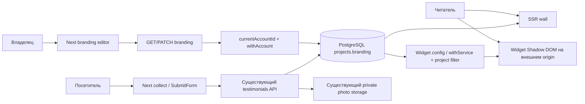

# Branding + collect — архитектура

Proposed, до QCSD/K1/K2. Решения ADR-001, ADR-002, ADR-003; app files не создавались.

## C4 Context / Container / Component

Внутри web: `branding.ts` — canonical reader, strict patch validator и contrast helper;
`project-branding.ts` — owned select/atomic merge; route — auth/origin/body/status boundary.
`branding-editor.tsx` — state/fetch; `branding-view.tsx` — pure UI. `collect-view.tsx`
выводит модель состояния; существующий SubmitForm сохраняет handlers/fetch/preview.
`intake-tabs.tsx` сохраняет flag policy. Изменения CSS scoped под новые формы/wall;
dashboard CSS/components не входят. У widget изменения только в его shadow-root.

## API design и sequence flows

GET `/api/projects/[slug]/branding`: 200 `{branding}`, 401 session absent, 404
foreign/missing/inactive, 503 DB failure. Private/no-store; owner page использует тот
же repository, не собственный service query. PATCH: auth → Origin/Fetch-Site → JSON
Content-Type → readBodyAtMost(4096) → parse/validate → tenant lock/merge → commit →200.
400 bad patch; 403 origin; 413 actual body bytes; 415 type; 409 stored non-object JSON;
503 permission/database fault. Body parsing до write transaction, auth чтение отдельно.
Ошибки `{errors:[...]}` или `{error:...}` совместимы с form status model.

Public reads: Branding defaults → theme tokens, validated accent + accessible foreground.
Wall query sort только из двух статических SQL вариантов, created_at/id tie-break.
Widget query CTE latest50 DESC,id DESC → outer requested order. Все filters до LIMIT.
DTO `branding` содержит только theme/accent_color/show_platform_labels; heading/logo
не обещаны widget UI. Older widget игнорирует добавленное поле; absent/new malformed
network values fail-safe в renderer, никакого raw CSS/innerHTML.
Source_label/source_url/screenshot остаются доступны: false выбирает neutral caption.
Server badge_required/badge_url logic не меняется; 50 не превращается в тарифный лимит.

## Data & storage / миграции

Новых SQL migrations **0**: existing projects.branding JSONB и grants достаточны по коду.
Read defaults дают additive rollout, старый reader продолжает понимать три старых ключа.
Обязательный schema test: создать отдельную БД существующими migrations, проверить
пустой/legacy/malformed JSON, независимые concurrent patches, имя, foreign RLS, revoked
UPDATE и rollback старого reader. Применять к production/общей БД запрещено.
Если окажется нужна новая SQL migration — сначала ADR/plan/targets/K1/K2 revision.
Logo browser-loaded HTTPS URL, не server-side fetch и не S3 uploader. Photo pipeline
reuse полностью; access contract и ограничения доказательств описаны в research.

## UI и QE

Frozen `reference/dashboard-v3`: branding/collect × 1440×900,390×844,360×800;
DPR1, ru-RU, UTC, frozen clock, fonts/browser/OS hashes, crop .cab-shell, zero masks.
Same production view + literal frozen model только в offline fixture. Existing visual
script already supports both screens; fixture server loopback, вне Next routes.
Production models не получают prototype rating/video/tariff promises. Live E2E отдельно:
обычный login, own/foreign/expired, save/reload, text/photo pending→approve→wall/widget,
400/429/503/network errors, focus/keyboard/long strings, false video flag.
Все external calls в тесте блокируются, storage synthetic/local; реальная почта/STT/payments не вызываются.
Новые states получают evidence и owner review отдельно, без обновления frozen goldens.

## Observability

PATCH логирует только outcome/status/error-code и технический request correlation,
без payload, отзывов, logo URL, session/cookie/token/photo keys. INFO success, WARN
validation/origin rejection, ERROR storage/DB permission failures. Новых dashboard
метрик не обещаем: из структурированных локальных логов считать success и failed writes.
Внешний симптом отказа — понятная ошибка с сохранённым draft, а не success toast.
Owner замечает отказ в UI; оператор/QA сверяет non-success counters и smoke read/reload.
Точный sink/format логов проверяется при реализации; наличие раздела не доказывает monitoring.
